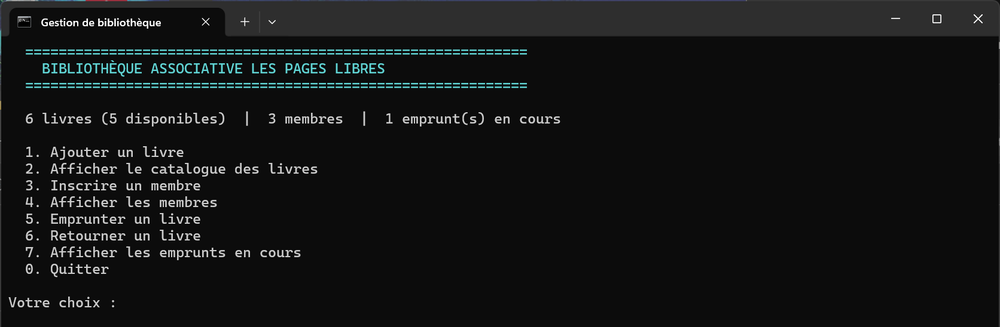
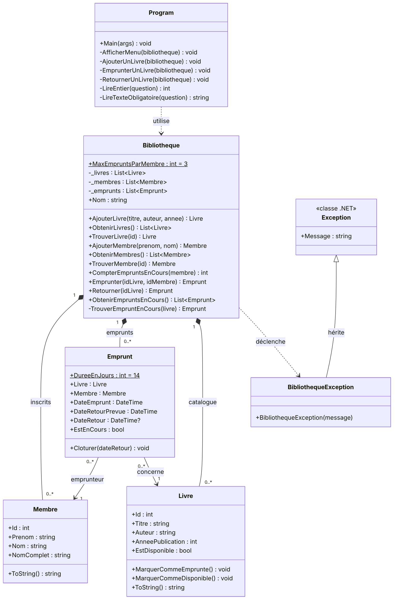
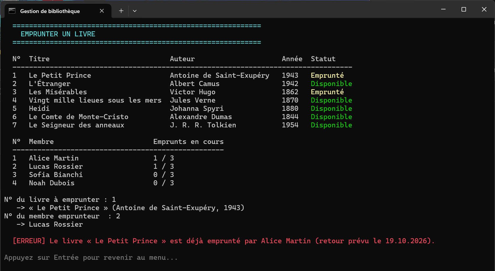
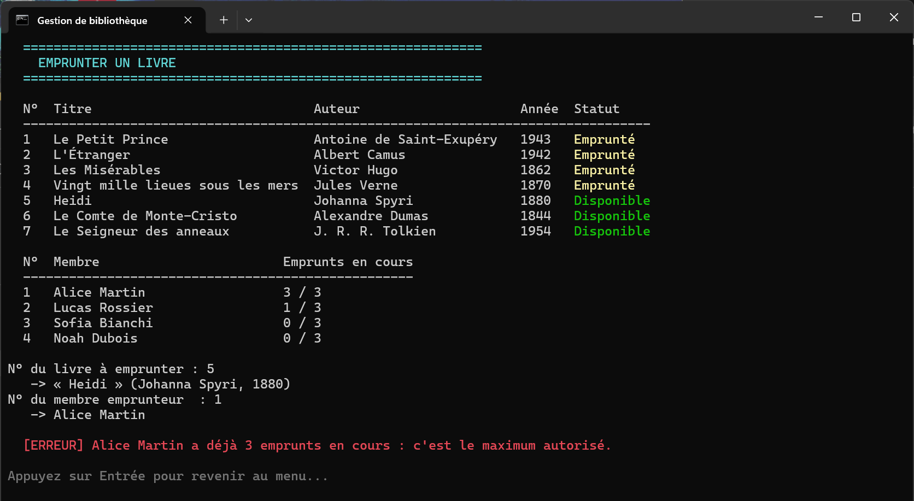

# Gestion de bibliothèque – application console en C#

Application console en **C# / .NET 10** qui gère le catalogue, les membres et les emprunts d'une petite bibliothèque associative.
Projet réalisé pendant la semaine PPE du cours *Algorithmique orientée C# – Concevoir et implémenter des applications* (CFC 319), classe E1B, Geneva Institute of Technology.



## Fonctionnalités

- **Catalogue** : ajouter un livre, afficher la liste avec la disponibilité de chaque livre
- **Membres** : inscrire un membre, afficher la liste avec le nombre d'emprunts en cours
- **Emprunts** : emprunter un livre (retour prévu à 14 jours), le retourner, lister les emprunts en cours
- **Erreurs gérées sans plantage** : livre déjà emprunté, livre ou membre inexistant, limite de 3 emprunts par membre, saisies invalides (champ vide, texte à la place d'un nombre, année impossible)

## Lancer le projet

Prérequis : le [SDK .NET 10](https://dotnet.microsoft.com/download) (inclus avec Visual Studio 2026).

- **Visual Studio** : ouvrir `GestionBibliotheque.slnx`, puis `Ctrl + F5`
- **Ligne de commande** :

```bash
dotnet run --project GestionBibliotheque
```

## Structure du dépôt

```text
.
├── GestionBibliotheque.slnx          solution Visual Studio
├── GestionBibliotheque/
│   ├── Program.cs                    interface console : menu, saisies, affichage
│   ├── Bibliotheque.cs               règles de gestion : ajout, emprunt, retour
│   ├── Livre.cs                      classe métier
│   ├── Membre.cs                     classe métier
│   ├── Emprunt.cs                    classe métier (relie un livre à un membre)
│   └── BibliothequeException.cs      erreur métier (hérite d'Exception)
├── docs/
│   ├── rendu-hackmd.md               rapport complet : démarche, code expliqué, jeu de tests
│   ├── diagramme-classes.png         diagramme de classes UML
│   └── diagramme-classes.mmd         source Mermaid du diagramme
└── captures/                         captures d'écran (création, code, compilation, tests)
```

## Diagramme de classes



## Tests

19 tests manuels enchaînés (cas normaux et cas d'erreur), **tous conformes**. Le tableau des tests et une capture par test sont dans [`docs/rendu-hackmd.md`](docs/rendu-hackmd.md).

| Exemple : emprunt d'un livre déjà emprunté | Exemple : limite de 3 emprunts |
|---|---|
|  |  |

## Notions mises en pratique

- Programmation orientée objet : classes, propriétés, constructeurs, encapsulation (`private`, `private set`), héritage (`BibliothequeException : Exception`), polymorphisme (`override ToString()`)
- Collections `List<T>` et recherche séquentielle
- Gestion des erreurs avec les exceptions (`throw`, `try` / `catch`)
- Validation des saisies au clavier (`int.TryParse`, champs obligatoires)

## Auteur

**Paul Giocanti** – étudiant en Bachelor (spécialité cybersécurité) au Geneva Institute of Technology, Genève · GitHub [@L4ami](https://github.com/L4ami)
